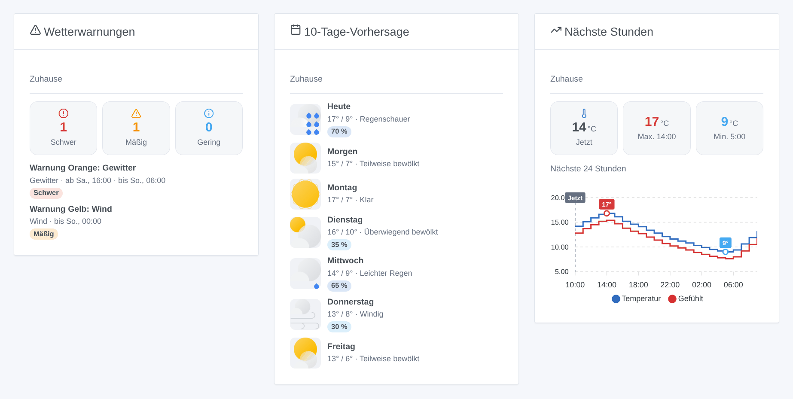
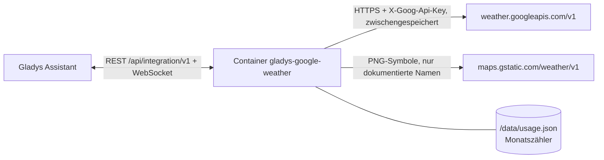
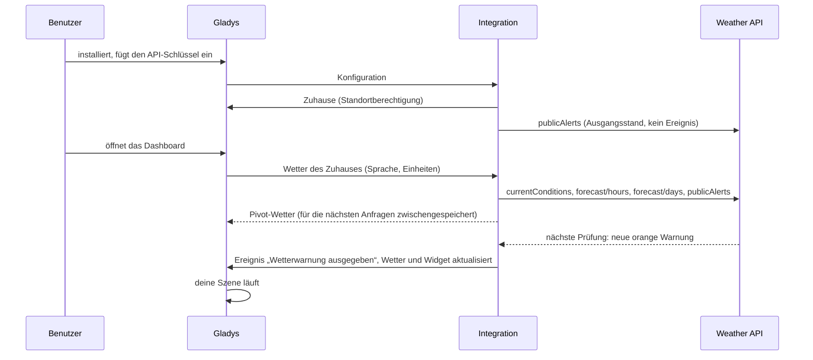

# Gladys Google Weather

[English](README.md) · [Français](README.fr.md) · **Deutsch** · [Español](README.es.md)

[](LICENSE)
[](https://github.com/William-De71/gladys-google-weather/releases)
[](https://github.com/William-De71/gladys-google-weather/actions/workflows/release.yml)
[](https://gladysassistant.com)


Externe Integration für [Gladys Assistant](https://gladysassistant.com), die die offizielle **Weather API der Google Maps Platform** zu einem Wetteranbieter von Gladys macht: aktuelles Wetter, stündliche und 10-Tage-Vorhersagen sowie die offiziellen öffentlichen Warnungen (MeteoAlarm, DWD, NOAA…). Dazu kommen Szenen-Auslöser, Szenen-Aktionen und drei Dashboard-Widgets – ausgelegt, um mit deinem eigenen API-Schlüssel im kostenlosen Monatskontingent von Google zu bleiben.

Benutzerdokumentation: [English](docs/en.md) · [Français](docs/fr.md) · [Deutsch](docs/de.md) · [Español](docs/es.md).

> Community-Integration, weder mit Google verbunden noch von Google unterstützt. **Bisher nie mit einem echten API-Schlüssel getestet**: Sie folgt der Dokumentation der API genau, Rückmeldungen sind willkommen.

## Funktionen

- **Wetteranbieter** (Typ `weather`): Die Wetterkarte von Gladys, der Chat-Assistent und der Wetterwarnungs-Auslöser nutzen ihn anstelle des eingebauten OpenWeather-Dienstes. Temperatur, gefühlte Temperatur, Luftfeuchtigkeit, Taupunkt, Luftdruck, Wind und Böen, Sichtweite, Bewölkung, UV-Index, Tag oder Nacht, Sonnenauf- und -untergang; 24 Stunden und 8 Tage (die Grenzen von Gladys); metrische oder US-Einheiten; Beschreibungen in der Sprache von Gladys.
- **Amtliche Warnungen** im Wetter von Gladys und in zwei **Szenen-Auslösern** (Warnung ausgegeben / beendet), filterbar nach Zuhause, Art der Warnung (15 Gruppen) und Schweregrad (MeteoAlarm-Farben: gelb = mäßig, orange = schwer, rot = extrem).
- **Szenen-Aktionen**: aktive Warnungen, Vorhersage eines Tages (bis in 9 Tagen), aktuelles Wetter, „wird es in den nächsten Stunden regnen?“.
- **Widgets**: Warnungen mit vollem Text, 5- bis 10-Tage-Vorhersage mit den Google-Symbolen, Verlauf der nächsten 12 oder 24 Stunden.
- **Kosten im Griff**: Antworten zwischengespeichert und geteilt, einstellbare Aktualisierungsintervalle, monatliche Anfragegrenze, die einen Neustart übersteht, Schaltfläche **API-Schlüssel testen** mit den verbrauchten Anfragen.
- Englisch, Französisch, Deutsch und Spanisch überall.



## Funktionsweise






Es gibt kein Gerät zu entdecken: Ein Wetteranbieter beantwortet die Wetteranfragen von Gladys, die die Koordinaten des Zuhauses enthalten.

### Transport

Nur Cloud (`transports: ["cloud"]`, Badge „Cloud“ im Katalog): Jede Anfrage verlässt dein Netzwerk mit den Koordinaten des Zuhauses in Richtung Google. Lokal läuft außer dem Cache nichts.

### Kosten und Aktualisierung

Google berechnet jede erfolgreiche Anfrage an die Weather API (alle Endpunkte zusammen, SKU „Weather Usage“) über **10.000 kostenlose Anfragen pro Monat** hinaus, danach 0,15 USD je 1.000 (Preise geprüft am 17.10.2026). Ein **Rechnungskonto ist Pflicht**, auch im kostenlosen Rahmen. Jedes Produkt wird höchstens einmal pro Intervall gelesen und von Dashboard, Widgets und Szenen geteilt:

| Produkt                        | Standardintervall   | Anfragen / Monat / Zuhause |
| ------------------------------ | ------------------- | -------------------------- |
| Aktuelles Wetter               | 30 min              | 1.488                      |
| Stündliche Vorhersage (24 h)   | 60 min              | 744                        |
| Tagesvorhersage (10 Tage)      | 3 × stündlich = 3 h | 248                        |
| Warnungen                      | 30 min              | 1.488                      |
| **Summe (Monat mit 31 Tagen)** |                     | **3.968**                  |

Die Integration fragt 24 Stunden und 10 Tage jeweils in einer einzigen Seite ab (die API liefert standardmäßig 5 Tage pro Seite, was die Kosten verdoppeln würde). Gladys prüft das Wetter für seinen eigenen Warnungs-Auslöser alle 30 Minuten: Kürzere Intervalle bringen nichts. Zwei Zuhause mit den Standardwerten bleiben unter der **monatlichen Grenze** von 9.000 Anfragen; darüber geht bis zum nächsten Monat kein Aufruf mehr an Google, und die letzten Antworten werden geliefert. Mehrere Dashboard-Sprachen vervielfachen die Kosten (eine Antwort pro Sprache).

## Voraussetzungen

- Gladys **5.3.0** oder neuer (ältere Versionen können die Integration nicht installieren: Widgets und Szenen, Katalog-Schlagwörter von Gladys 5.3).
- Ein Zuhause mit Standort in Gladys.
- Ein Google-Cloud-Projekt mit Rechnungskonto, aktivierter **Weather API** und einem API-Schlüssel, am besten **auf die Weather API beschränkt** (und auf deine öffentliche IP, falls sie fest ist). Schritt für Schritt in der [Dokumentation](docs/de.md#konfiguration).

## Installation

- **Aus dem Store**: Integrationen → Google Weather → Installieren.
- **Über die Repository-URL**: Integrationen → Externe Integration hinzufügen → `https://github.com/William-De71/gladys-google-weather`.
- **Entwicklermodus**: `npm install`, dann neben einem Gladys im Entwicklermodus mit den Variablen unten starten.

## Konfiguration

| Feld                         | Standard | Zweck                                                         |
| ---------------------------- | -------- | ------------------------------------------------------------- |
| API-Schlüssel                | —        | Dein Google-Cloud-Schlüssel (`AIza…`), ein `secret`-Feld      |
| Aktuelles Wetter alle (Min.) | 30       | 10 bis 180                                                    |
| Stündliche Vorhersage alle   | 60       | 30 bis 360; die Tagesvorhersage wird dreimal seltener gelesen |
| Amtliche Warnungen           | an       | Ausschalten, wo Google keine veröffentlicht                   |
| Warnungen alle (Min.)        | 30       | 10 bis 180: Verzögerung, bis eine Warnung die Szenen erreicht |
| Monatliche Anfragegrenze     | 9.000    | Sicherheitsnetz, 100 bis 1.000.000                            |

Konfigurationsaktion: **API-Schlüssel testen** (eine Anfrage: aktuelles Wetter des ersten Zuhauses, Anfragen dieses Monats und Monatsschätzung).

## Verwendung

Schlüssel einfügen, auf **API-Schlüssel testen** klicken, dann die Widgets zu einem Dashboard hinzufügen und Szenen mit dem Auslöser „Wetterwarnung ausgegeben“ oder den Wetteraktionen erstellen. Die Wetterkarte von Gladys nutzt diesen Anbieter automatisch (oder hefte ihn in den Einstellungen der Karte an, wenn mehrere Anbieter installiert sind). Abdeckung: Wetter und Vorhersagen decken die meisten Länder ab (nicht China, Japan, Südkorea, Vietnam, Iran, Nordkorea, Kuba, Syrien…); Warnungen decken Frankreich und den Großteil Europas – Deutschland mit dem DWD –, die USA, Australien, Brasilien, Japan… ab, aber unter anderem nicht Kanada, Indien oder Russland. Außerhalb der Wetterabdeckung nutzt Gladys seinen nächsten Anbieter.

## Entwicklung

```bash
npm install
npm test                     # node --test, nie mit Netzwerkzugriff
npm run lint && npm run format:check
npx github:GladysAssistant/integration-store . --skip-image-check
docs/illustrations/render.sh # Widget-Illustrationen
scripts/build-cover.sh       # cover.jpg
```

Umgebungsvariablen (vom Gladys-Supervisor gesetzt): `GLADYS_HOST_API_URL`, `GLADYS_INTEGRATION_TOKEN`, `GLADYS_INTEGRATION_SELECTOR` und `TZ` (Ersatz-Zeitzone der Texte). Die Integration schreibt nur `/data/usage.json` (den monatlichen Anfragezähler).

## Release-Prozess


Jeder Merge auf `main` startet die CI und berechnet dann die Version aus den [Conventional Commits](https://www.conventionalcommits.org/) seit dem letzten Tag: `feat` → Minor, `fix` / `perf` → Patch, `!` oder `BREAKING CHANGE` → Major (unter 1.0.0 ein Minor); `docs`, `chore`, `ci`, `test`, `style`, `refactor`, `build` allein veröffentlichen nichts. Ohne Tag wird 0.1.0 unverändert veröffentlicht. Der Changelog-Abschnitt wird erzeugt, der Tag gepusht, das Multi-Architektur-Image gebaut, dann erhält `main` den Release-Commit (der Store sieht also nie eine Version ohne Image), das GitHub Release wird erstellt und ein letzter Job prüft das öffentliche Image, den Store-Validator und das Topic.

- Der Titel des Pull Requests wird zum Squash-Commit und dann zur Changelog-Zeile: auf Englisch, für den Benutzer formulieren (`pr-title.yml` prüft es). `CHANGELOG.md` nie von Hand bearbeiten.
- 1.0.0 ist eine Entscheidung: Actions → Release → Run workflow mit `release-as: 1.0.0`. `dry-run` zeigt Version und Notizen, ohne etwas zu veröffentlichen.
- **Geschützter Branch**: Das Release pusht seinen Commit mit `GITHUB_TOKEN` auf `main`. Mit einem Ruleset auf `main` GitHub Actions zur Bypass-Liste hinzufügen (oder über eine GitHub App pushen), sonst schlägt der Veröffentlichungsjob fehl.
- Nach dem ersten Release muss das Paket auf `ghcr.io` öffentlich sein (Package settings → Change visibility).

## Fehlerbehebung

Siehe [docs/de.md](docs/de.md#fehlerbehebung) (Schlüssel abgelehnt, API nicht aktiviert, Abrechnung deaktiviert, Schlüsseleinschränkungen, keine Warnungen im eigenen Land, Grenze erreicht). Melde Probleme mit den Versionen von Gladys und der Integration, dem Land des Zuhauses und dem Ergebnis von **API-Schlüssel testen** (Einstellungen → Supervision für die Logs).

## Mitwirken

Issues und Pull Requests sind willkommen. Vor einem Pull Request `npm run format:check && npm run lint && npm test` ausführen und keinen gespeicherten Schlüssel ändern (siehe [CLAUDE.md](CLAUDE.md)).

## Sicherheit

Siehe [SECURITY.md](SECURITY.md): Sicherheitslücken bitte privat melden. Der API-Schlüssel ist ein `secret`-Feld, wird in einem Header gesendet (nie in einer URL) und nie geloggt. Widget-Symbole werden nur von `https://maps.gstatic.com/weather/v1/<dokumentierter Name>.png` geladen, egal was die API antwortet.

## Kommende Screenshots

Die Bilder oben sind Illustrationen, keine Screenshots. Echte Screenshots kommen nach `docs/assets/screenshots/` (PNG, 1280 × 800): `configuration.png`, `test-api-key.png`, `weather-card.png`, `scene-trigger.png`.

## Lizenz

[Apache License 2.0](LICENSE) – siehe auch [NOTICE](NOTICE). Google und Google Maps Platform sind Marken von Google LLC; diese Community-Integration ist nicht mit Google verbunden. Danke an die Dokumentation und das SDK von Gladys.
