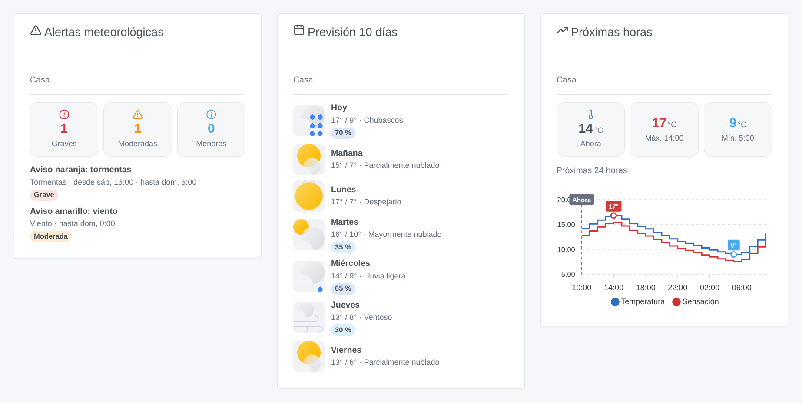
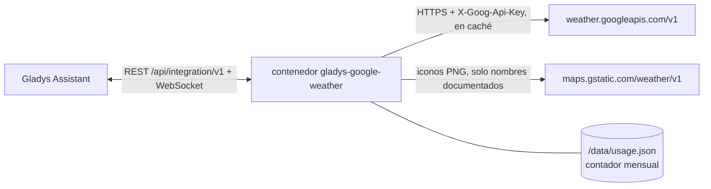
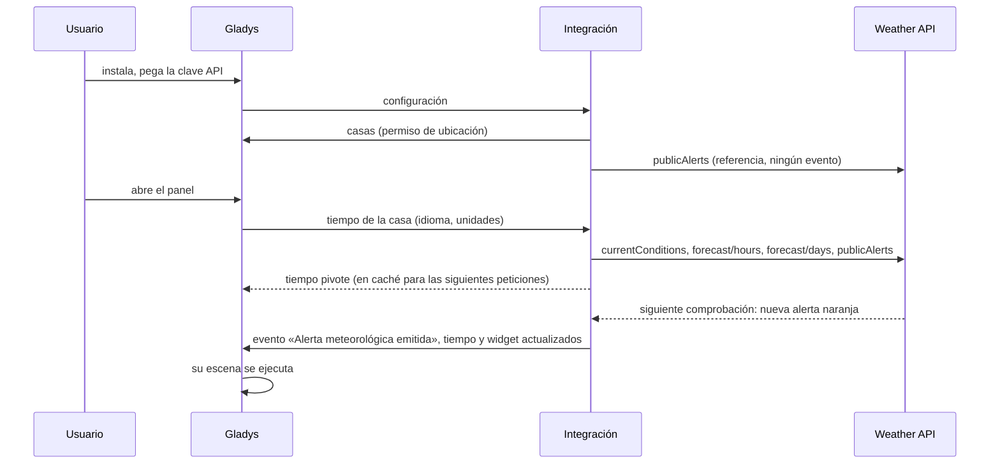

# Gladys Google Weather

[English](README.md) · [Français](README.fr.md) · [Deutsch](README.de.md) · **Español**

[](LICENSE)
[](https://github.com/William-De71/gladys-google-weather/releases)
[](https://github.com/William-De71/gladys-google-weather/actions/workflows/release.yml)
[](https://gladysassistant.com)


Integración externa de [Gladys Assistant](https://gladysassistant.com) que convierte la **Weather API oficial de Google Maps Platform** en un proveedor meteorológico de Gladys: condiciones actuales, previsiones por horas y a 10 días, y las alertas públicas oficiales (MeteoAlarm, DWD, NOAA…). Se añaden activadores y acciones de escena y tres widgets de panel, pensados para mantenerse dentro del uso gratuito mensual de Google con su propia clave API.

Documentación de usuario: [English](docs/en.md) · [Français](docs/fr.md) · [Deutsch](docs/de.md) · [Español](docs/es.md).

> Integración comunitaria, sin afiliación ni respaldo de Google. **Nunca probada con una clave API real hasta ahora**: sigue al pie de la letra la documentación de la API, y los comentarios son bienvenidos.

## Funciones

- **Proveedor meteorológico** (tipo `weather`): la tarjeta del tiempo de Gladys, el asistente de chat y el activador de alerta meteorológica lo usan en lugar del servicio OpenWeather integrado. Temperatura, sensación térmica, humedad, punto de rocío, presión, viento y rachas, visibilidad, nubosidad, índice UV, día o noche, salida y puesta del sol; 24 horas y 8 días (los límites de Gladys); unidades métricas o de EE. UU.; descripciones en el idioma de Gladys.
- **Alertas oficiales** en el tiempo de Gladys y en dos **activadores de escena** (alerta emitida / finalizada), filtrables por casa, tipo de alerta (15 grupos) y gravedad (colores MeteoAlarm: amarillo = moderada, naranja = grave, rojo = extrema).
- **Acciones de escena**: las alertas en vigor, la previsión de un día (hasta dentro de 9 días), el tiempo actual, «¿va a llover en las próximas horas?».
- **Widgets**: alertas con su texto completo, previsión de 5 a 10 días con los iconos de Google, curva de las próximas 12 o 24 horas.
- **Coste controlado**: respuestas en caché y compartidas, intervalos de actualización ajustables, límite mensual de solicitudes que sobrevive a un reinicio, botón **Probar la clave API** que muestra las solicitudes consumidas.
- Inglés, francés, alemán y español en todas partes.



## Cómo funciona






No hay ningún dispositivo que descubrir: un proveedor meteorológico responde a las peticiones de tiempo de Gladys, que llevan las coordenadas de la casa.

### Transporte

Solo nube (`transports: ["cloud"]`, insignia «nube» en el catálogo): cada solicitud sale de su red hacia Google con las coordenadas de la casa. Nada se ejecuta en local salvo la caché.

### Coste y actualización

Google factura cada solicitud correcta a la Weather API (todos los endpoints juntos, SKU «Weather Usage») por encima de **10 000 solicitudes gratuitas al mes**, y luego 0,15 USD por cada 1000 (precios comprobados el 17/10/2026). Una **cuenta de facturación es obligatoria**, incluso dentro del uso gratuito. Cada producto se lee como mucho una vez por intervalo y lo comparten el panel, los widgets y las escenas:

| Producto                   | Intervalo por defecto | Solicitudes / mes / casa |
| -------------------------- | --------------------- | ------------------------ |
| Condiciones actuales       | 30 min                | 1488                     |
| Previsión por horas (24 h) | 60 min                | 744                      |
| Previsión diaria (10 días) | 3 × por horas = 3 h   | 248                      |
| Alertas                    | 30 min                | 1488                     |
| **Total (mes de 31 días)** |                       | **3968**                 |

La integración pide 24 horas y 10 días en una sola página cada uno (la API devuelve 5 días por página por defecto, lo que duplicaría el coste). Gladys comprueba el tiempo cada 30 minutos para su propio activador de alertas: intervalos más cortos no sirven de nada. Dos casas con los valores por defecto quedan por debajo del **límite mensual** de 9000 solicitudes; superado este, no sale ninguna llamada a Google hasta el mes siguiente y se sirven las últimas respuestas. Varios idiomas de panel multiplican el coste (una respuesta por idioma).

## Requisitos

- Gladys **5.1.1** o posterior (las versiones anteriores no pueden instalar la integración: widgets y escenas).
- Una casa con ubicación en Gladys.
- Un proyecto de Google Cloud con una cuenta de facturación, la **Weather API** activada y una clave API, preferiblemente **restringida a la Weather API** (y a su IP pública si es fija). Paso a paso en la [documentación](docs/es.md#configuración).

## Instalación

- **Desde la tienda**: Integraciones → Google Weather → Instalar.
- **Desde la URL del repositorio**: Integraciones → Añadir una integración externa → `https://github.com/William-De71/gladys-google-weather`.
- **Modo desarrollador**: `npm install`, y luego ejecútela junto a un Gladys en modo desarrollador con las variables de abajo.

## Configuración

| Campo                           | Por defecto | Función                                                        |
| ------------------------------- | ----------- | -------------------------------------------------------------- |
| Clave API                       | —           | Su clave de Google Cloud (`AIza…`), un campo `secret`          |
| Condiciones actuales cada (min) | 30          | 10 a 180                                                       |
| Previsión por horas cada (min)  | 60          | 30 a 360; la diaria se lee 3 veces menos                       |
| Alertas oficiales               | sí          | Desactívelas donde Google no publica                           |
| Alertas cada (min)              | 30          | 10 a 180: retraso antes de que una alerta llegue a las escenas |
| Límite mensual de solicitudes   | 9000        | Red de seguridad, 100 a 1 000 000                              |

Acción de configuración: **Probar la clave API** (una solicitud: el tiempo actual de la primera casa, las solicitudes del mes y la estimación mensual).

## Uso

Pegue la clave, pulse **Probar la clave API**, añada los widgets a un panel y cree escenas con el activador «Alerta meteorológica emitida» o con las acciones meteorológicas. La tarjeta del tiempo de Gladys usa este proveedor automáticamente (o fíjelo en los ajustes de la tarjeta si hay varios proveedores instalados). Cobertura: el tiempo y las previsiones cubren la mayoría de los países (no China, Japón, Corea del Sur, Vietnam, Irán, Corea del Norte, Cuba, Siria…); las alertas cubren Francia y la mayor parte de Europa —España incluida, vía MeteoAlarm—, Estados Unidos, Australia, Brasil, Japón… pero no Canadá, India ni Rusia, entre otros. Fuera de la cobertura meteorológica, Gladys pasa a su siguiente proveedor.

## Desarrollo

```bash
npm install
npm test                     # node --test, nunca toca la red
npm run lint && npm run format:check
npx github:GladysAssistant/integration-store . --skip-image-check
docs/illustrations/render.sh # ilustraciones de los widgets
scripts/build-cover.sh       # cover.jpg
```

Variables de entorno (definidas por el supervisor de Gladys): `GLADYS_HOST_API_URL`, `GLADYS_INTEGRATION_TOKEN`, `GLADYS_INTEGRATION_SELECTOR` y `TZ` (zona horaria de respaldo de los textos). La integración solo escribe `/data/usage.json` (el contador mensual de solicitudes).

## Proceso de publicación


Cada fusión en `main` lanza la CI y luego calcula la versión a partir de los [Conventional Commits](https://www.conventionalcommits.org/) desde la última etiqueta: `feat` → menor, `fix` / `perf` → parche, `!` o `BREAKING CHANGE` → mayor (una menor mientras la versión sea inferior a 1.0.0); `docs`, `chore`, `ci`, `test`, `style`, `refactor`, `build` solos no publican nada. Sin etiqueta, 0.1.0 se publica tal cual. Se genera la sección del changelog, se sube la etiqueta, se construye la imagen multiarquitectura, luego `main` recibe el commit de publicación (la tienda nunca ve una versión sin su imagen), se crea la GitHub Release y un último job comprueba la imagen pública, el validador de la tienda y el topic.

- El título de la pull request se convierte en el commit squash y luego en la línea del changelog: escríbalo en inglés, para el usuario (`pr-title.yml` lo comprueba). No edite nunca `CHANGELOG.md` a mano.
- La 1.0.0 es una decisión: Actions → Release → Run workflow con `release-as: 1.0.0`. `dry-run` muestra la versión y las notas sin publicar nada.
- **Rama protegida**: la publicación sube su commit a `main` con `GITHUB_TOKEN`. Con un ruleset en `main`, añada GitHub Actions a su lista de omisión (o suba mediante una GitHub App); si no, el job de publicación falla.
- Tras la primera publicación, el paquete de `ghcr.io` debe ser público (Package settings → Change visibility).

## Solución de problemas

Consulte [docs/es.md](docs/es.md#solución-de-problemas) (clave rechazada, API no activada, facturación desactivada, restricciones de clave, ninguna alerta en su país, límite alcanzado). Informe de los problemas con las versiones de Gladys y de la integración, el país de la casa y el resultado de **Probar la clave API** (Ajustes → Supervisión para los registros).

## Contribuir

Las issues y pull requests son bienvenidas. Ejecute `npm run format:check && npm run lint && npm test` antes de abrir una pull request y no cambie ninguna clave almacenada (véase [CLAUDE.md](CLAUDE.md)).

## Seguridad

Consulte [SECURITY.md](SECURITY.md): informe de las vulnerabilidades en privado. La clave API es un campo `secret`, se envía en una cabecera (nunca en una URL) y nunca se registra. Los iconos de los widgets solo se descargan de `https://maps.gstatic.com/weather/v1/<nombre documentado>.png`, responda lo que responda la API.

## Capturas de pantalla pendientes

Las imágenes de arriba son ilustraciones, no capturas de pantalla. Las capturas reales irán en `docs/assets/screenshots/` (PNG, 1280 × 800): `configuration.png`, `test-api-key.png`, `weather-card.png`, `scene-trigger.png`.

## Licencia

[Apache License 2.0](LICENSE) — véase también [NOTICE](NOTICE). Google y Google Maps Platform son marcas de Google LLC; esta integración comunitaria no está afiliada a ella. Gracias a la documentación y al SDK de Gladys.
