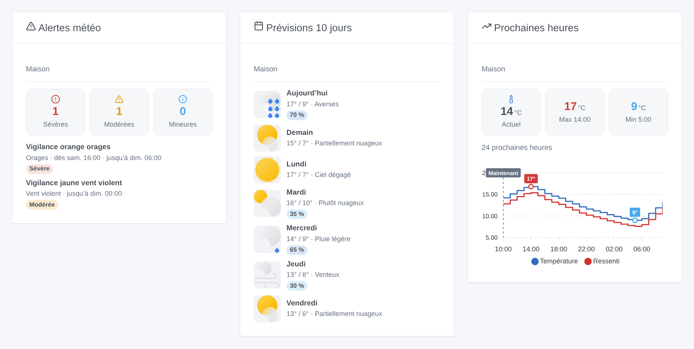
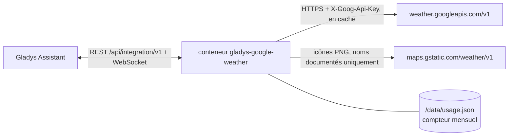
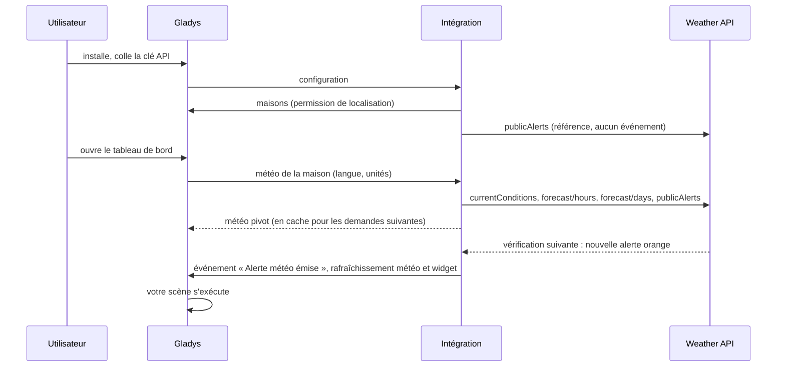

# Gladys Google Weather

[English](README.md) · **Français** · [Deutsch](README.de.md) · [Español](README.es.md)

[](LICENSE)
[](https://github.com/William-De71/gladys-google-weather/releases)
[](https://github.com/William-De71/gladys-google-weather/actions/workflows/release.yml)
[](https://gladysassistant.com)


Intégration externe de [Gladys Assistant](https://gladysassistant.com) qui fait de la **Weather API officielle de Google Maps Platform** un fournisseur météo de Gladys : conditions actuelles, prévisions horaires et à 10 jours, et alertes publiques officielles (MeteoAlarm, DWD, NOAA…). S'y ajoutent des déclencheurs et actions de scène et trois widgets de tableau de bord, conçus pour rester dans l'usage gratuit mensuel de Google avec votre propre clé API.

Documentation utilisateur : [English](docs/en.md) · [Français](docs/fr.md) · [Deutsch](docs/de.md) · [Español](docs/es.md).

> Intégration communautaire, ni affiliée ni approuvée par Google. **Jamais testée avec une vraie clé API à ce jour** : elle suit la documentation de l'API à la lettre, et les retours sont les bienvenus.

## Fonctionnalités

- **Fournisseur météo** (type `weather`) : la carte météo de Gladys, l'assistant de chat et le déclencheur d'alerte météo l'utilisent à la place du service OpenWeather intégré. Température, ressenti, humidité, point de rosée, pression, vent et rafales, visibilité, couverture nuageuse, indice UV, jour ou nuit, lever et coucher du soleil ; 24 heures et 8 jours (les limites de Gladys) ; unités métriques ou US ; descriptions dans la langue de Gladys.
- **Alertes officielles** dans la météo de Gladys et dans deux **déclencheurs de scène** (alerte émise / terminée), filtrables par maison, type d'alerte (15 groupes) et sévérité (couleurs MeteoAlarm / vigilance : jaune = modérée, orange = sévère, rouge = extrême).
- **Actions de scène** : les alertes en cours, les prévisions d'un jour (jusqu'à J+9), la météo actuelle, « va-t-il pleuvoir dans les prochaines heures ? ».
- **Widgets** : alertes avec leur texte complet, prévisions de 5 à 10 jours avec les icônes de Google, courbe des 12 ou 24 prochaines heures.
- **Coût maîtrisé** : réponses mises en cache et partagées, intervalles de rafraîchissement réglables, plafond mensuel de requêtes conservé au redémarrage, bouton **Tester la clé API** qui affiche les requêtes consommées.
- Anglais, français, allemand et espagnol partout.



## Fonctionnement






Il n'y a pas d'appareil à découvrir : un fournisseur météo répond aux demandes météo de Gladys, qui portent les coordonnées de la maison.

### Transport

Cloud uniquement (`transports: ["cloud"]`, badge « cloud » dans le catalogue) : chaque requête sort de votre réseau vers Google avec les coordonnées de la maison. Rien ne tourne en local à part le cache.

### Coût et rafraîchissement

Google facture chaque requête réussie à la Weather API (tous les endpoints ensemble, SKU « Weather Usage ») au-delà de **10 000 requêtes gratuites par mois**, puis 0,15 USD les 1 000 (tarifs vérifiés le 17/10/2026). Un **compte de facturation est obligatoire**, même dans l'usage gratuit. Chaque produit est lu au plus une fois par intervalle et partagé par le tableau de bord, les widgets et les scènes :

| Produit                    | Intervalle par défaut | Requêtes / mois / maison |
| -------------------------- | --------------------- | ------------------------ |
| Conditions actuelles       | 30 min                | 1 488                    |
| Prévisions horaires (24 h) | 60 min                | 744                      |
| Prévisions journalières    | 3 × horaire = 3 h     | 248                      |
| Alertes                    | 30 min                | 1 488                    |
| **Total (mois de 31 j)**   |                       | **3 968**                |

L'intégration demande 24 heures et 10 jours en une seule page chacun (l'API renvoie 5 jours par page par défaut, ce qui doublerait le coût). Gladys vérifie la météo toutes les 30 minutes pour son propre déclencheur d'alerte : des intervalles plus courts ne servent à rien. Deux maisons avec les valeurs par défaut restent sous le **plafond mensuel** de 9 000 requêtes ; au-delà, plus aucun appel ne part chez Google avant le mois suivant et les dernières réponses sont servies. Plusieurs langues de tableau de bord multiplient le coût (une réponse par langue).

## Prérequis

- Gladys **5.1.1** ou plus récent (les versions antérieures ne peuvent pas installer l'intégration : widgets et scènes).
- Une maison localisée dans Gladys.
- Un projet Google Cloud avec un compte de facturation, la **Weather API** activée et une clé API, de préférence **restreinte à la Weather API** (et à votre IP publique si elle est fixe). Pas à pas dans la [documentation](docs/fr.md#configuration).

## Installation

- **Depuis le store** : Intégrations → Google Weather → Installer.
- **Depuis l'URL du dépôt** : Intégrations → Ajouter une intégration externe → `https://github.com/William-De71/gladys-google-weather`.
- **Mode développeur** : `npm install`, puis lancez-la à côté d'un Gladys en mode développeur avec les variables ci-dessous.

## Configuration

| Champ                                 | Défaut | Rôle                                                       |
| ------------------------------------- | ------ | ---------------------------------------------------------- |
| Clé API                               | —      | Votre clé Google Cloud (`AIza…`), un champ `secret`        |
| Conditions actuelles toutes les (min) | 30     | 10 à 180                                                   |
| Prévisions horaires toutes les (min)  | 60     | 30 à 360 ; les journalières sont lues 3 fois moins souvent |
| Alertes officielles                   | oui    | À désactiver là où Google n'en publie pas                  |
| Alertes toutes les (min)              | 30     | 10 à 180 : délai avant qu'une alerte n'atteigne les scènes |
| Plafond mensuel de requêtes           | 9 000  | Filet de sécurité, 100 à 1 000 000                         |

Action de configuration : **Tester la clé API** (une requête : la météo actuelle de la première maison, les requêtes du mois et l'estimation mensuelle).

## Utilisation

Collez la clé, cliquez sur **Tester la clé API**, puis ajoutez les widgets à un tableau de bord et créez des scènes avec le déclencheur « Alerte météo émise » ou les actions météo. La carte météo de Gladys utilise ce fournisseur automatiquement (ou épinglez-le dans les réglages de la carte si plusieurs fournisseurs sont installés). Couverture : la météo et les prévisions couvrent la plupart des pays (pas la Chine, le Japon, la Corée du Sud, le Viêt Nam, l'Iran, la Corée du Nord, Cuba, la Syrie…) ; les alertes couvrent la France et la majeure partie de l'Europe, les États-Unis, l'Australie, le Brésil, le Japon… mais pas le Canada, l'Inde ni la Russie, entre autres. Hors de la couverture météo, Gladys passe à son fournisseur suivant.

## Développement

```bash
npm install
npm test                     # node --test, ne touche jamais le réseau
npm run lint && npm run format:check
npx github:GladysAssistant/integration-store . --skip-image-check
docs/illustrations/render.sh # illustrations des widgets
scripts/build-cover.sh       # cover.jpg
```

Variables d'environnement (posées par le superviseur de Gladys) : `GLADYS_HOST_API_URL`, `GLADYS_INTEGRATION_TOKEN`, `GLADYS_INTEGRATION_SELECTOR`, et `TZ` (fuseau de repli des textes). L'intégration n'écrit que `/data/usage.json` (le compteur mensuel de requêtes).

## Processus de release


Chaque fusion sur `main` lance la CI, puis calcule la version à partir des [Conventional Commits](https://www.conventionalcommits.org/) depuis le dernier tag : `feat` → mineure, `fix` / `perf` → correctif, `!` ou `BREAKING CHANGE` → majeure (une mineure tant que la version est inférieure à 1.0.0) ; `docs`, `chore`, `ci`, `test`, `style`, `refactor`, `build` seuls ne publient rien. Sans tag, 0.1.0 est publiée telle quelle. La section du changelog est générée, le tag poussé, l'image multi-architecture construite, puis `main` reçoit le commit de release (le store ne voit donc jamais une version sans son image), la GitHub Release est créée et un dernier job vérifie l'image publique, le validateur du store et le topic.

- Le titre de la pull request devient le commit squash, puis la ligne du changelog : écrivez-le en anglais, pour l'utilisateur (`pr-title.yml` le vérifie). N'éditez jamais `CHANGELOG.md` à la main.
- La 1.0.0 est une décision : Actions → Release → Run workflow avec `release-as: 1.0.0`. `dry-run` affiche la version et les notes sans rien publier.
- **Branche protégée** : la release pousse son commit sur `main` avec `GITHUB_TOKEN`. Avec un ruleset sur `main`, ajoutez GitHub Actions à sa liste de contournement (ou poussez via une GitHub App), sinon le job de publication échoue.
- Après la première release, le package `ghcr.io` doit être public (Package settings → Change visibility).

## Dépannage

Voir [docs/fr.md](docs/fr.md#dépannage) (clé refusée, API non activée, facturation désactivée, restrictions de clé, pas d'alerte dans votre pays, plafond atteint). Signalez un problème avec les versions de Gladys et de l'intégration, le pays de la maison et le résultat de **Tester la clé API** (Paramètres → Supervision pour les logs).

## Contribuer

Les issues et pull requests sont les bienvenues. Lancez `npm run format:check && npm run lint && npm test` avant d'ouvrir une pull request, et ne changez aucune clé stockée (voir [CLAUDE.md](CLAUDE.md)).

## Sécurité

Voir [SECURITY.md](SECURITY.md) : signalez les vulnérabilités en privé. La clé API est un champ `secret`, envoyée dans un en-tête (jamais dans une URL) et jamais écrite dans les logs. Les icônes des widgets ne sont téléchargées que depuis `https://maps.gstatic.com/weather/v1/<nom documenté>.png`, quoi que réponde l'API.

## Captures d'écran à venir

Les images ci-dessus sont des illustrations, pas des captures d'écran. Les vraies captures iront dans `docs/assets/screenshots/` (PNG, 1280 × 800) : `configuration.png`, `test-api-key.png`, `weather-card.png`, `scene-trigger.png`.

## Licence

[Apache License 2.0](LICENSE) — voir aussi [NOTICE](NOTICE). Google et Google Maps Platform sont des marques de Google LLC ; cette intégration communautaire n'y est pas affiliée. Merci à la documentation et au SDK de Gladys.
