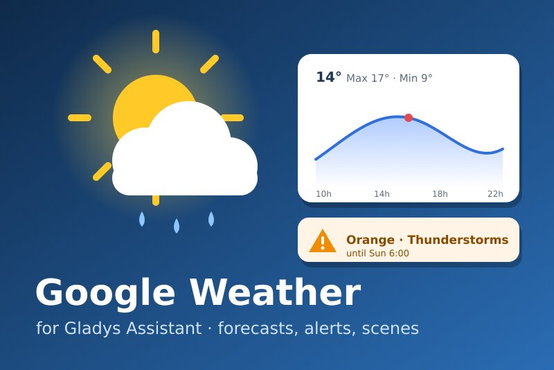
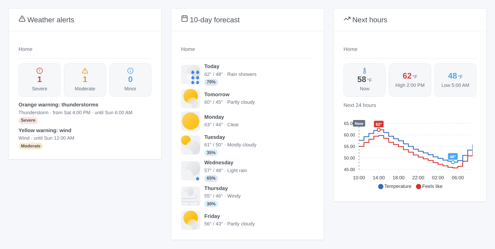
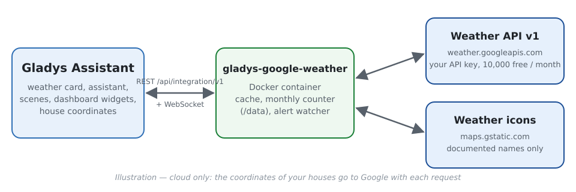
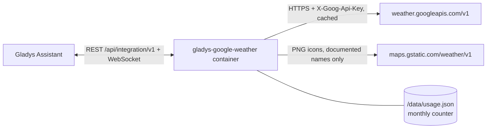
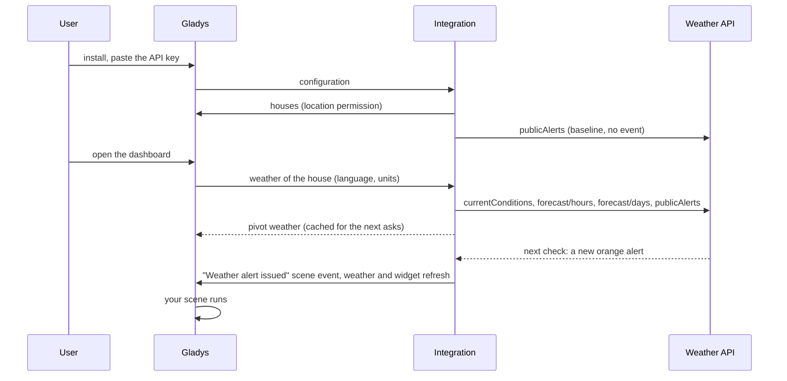

# Gladys Google Weather

**English** · [Français](README.fr.md) · [Deutsch](README.de.md) · [Español](README.es.md)

[](LICENSE)
[](https://github.com/William-De71/gladys-google-weather/releases)
[](https://github.com/William-De71/gladys-google-weather/actions/workflows/release.yml)
[](https://gladysassistant.com)



[Gladys Assistant](https://gladysassistant.com) external integration that makes the official **Weather API of Google Maps Platform** a weather provider of Gladys: current conditions, hourly and 10-day forecasts, and the official public alerts (MeteoAlarm, DWD, NOAA…). Scene triggers, scene actions and three dashboard widgets come on top, designed to stay within Google's free monthly usage with your own API key.

User documentation: [English](docs/en.md) · [Français](docs/fr.md) · [Deutsch](docs/de.md) · [Español](docs/es.md).

> Community integration, not affiliated with nor endorsed by Google. **Never tested with a real API key yet**: it follows the documentation of the API to the letter, and feedback is welcome.

## Features

- **Weather provider** (type `weather`): Gladys's weather card, chat assistant and weather-alert trigger use it instead of the built-in OpenWeather service. Temperature, feels like, humidity, dew point, pressure, wind and gusts, visibility, cloud cover, UV index, day or night, sunrise and sunset; 24 hours and 8 days (Gladys's limits); metric or US units; descriptions in the language of Gladys.
- **Official alerts** in the weather of Gladys and in two **scene triggers** (alert issued / ended), filtered by house, kind of alert (15 groups) and severity (MeteoAlarm colors: yellow = moderate, orange = severe, red = extreme).
- **Scene actions**: the alerts in force, the forecast of a day (up to 9 days ahead), the current weather, "is rain expected in the next hours?".
- **Widgets**: alerts with their full text, a 5- to 10-day forecast with Google's icons, a curve of the next 12 or 24 hours.
- **Cost under control**: answers cached and shared, adjustable refresh intervals, a monthly request cap kept across restarts, a **Test the API key** button showing the requests used.
- English, French, German and Spanish everywhere.



## How it works







There is no device to discover: a weather provider answers Gladys's weather requests, which carry the coordinates of the house.

### Transport

Cloud only (`transports: ["cloud"]`, "cloud" badge in the catalog): every request leaves your network for Google with the coordinates of the house. Nothing runs locally besides the cache.

### Cost and refresh

Google bills every successful request to the Weather API (all endpoints together, SKU "Weather Usage") beyond **10,000 free requests a month**, then USD 0.15 per 1,000 (pricing checked on 2026-10-17). A **billing account is mandatory**, even within the free usage. Each product is fetched at most once per interval and shared by the dashboard, the widgets and the scenes:

| Product                  | Default interval | Requests / month / house |
| ------------------------ | ---------------- | ------------------------ |
| Current conditions       | 30 min           | 1,488                    |
| Hourly forecast (24 h)   | 60 min           | 744                      |
| Daily forecast (10 d)    | 3 × hourly = 3 h | 248                      |
| Alerts                   | 30 min           | 1,488                    |
| **Total (31-day month)** |                  | **3,968**                |

The integration asks for 24 hours and 10 days in a single page each (the API defaults to 5 days a page, which would double the cost). Gladys checks the weather every 30 minutes for its own alert trigger: shorter intervals are not useful. Two houses with the defaults stay under the **monthly cap** of 9,000 requests; past it, no call goes to Google until the next month and the last answers are served. Several dashboard languages multiply the cost (one answer per language).

## Requirements

- Gladys **5.1.1** or later (older versions cannot install the integration: widgets and scenes).
- A house with a location in Gladys.
- A Google Cloud project with a billing account, the **Weather API** enabled and an API key, ideally **restricted to the Weather API** (and to your public IP if it is fixed). Step by step in the [documentation](docs/en.md#configuration).

## Installation

- **From the store**: Integrations → Google Weather → Install.
- **From the repository URL**: Integrations → Add an external integration → `https://github.com/William-De71/gladys-google-weather`.
- **Developer mode**: `npm install`, then run it next to a Gladys in developer mode with the variables below.

## Configuration

| Field                          | Default | Purpose                                                  |
| ------------------------------ | ------- | -------------------------------------------------------- |
| API key                        | —       | Your Google Cloud key (`AIza…`), a `secret` field        |
| Current conditions every (min) | 30      | 10 to 180                                                |
| Hourly forecast every (min)    | 60      | 30 to 360; the daily forecast is read 3 times less often |
| Official alerts                | on      | Switch off where Google publishes none                   |
| Alerts every (min)             | 30      | 10 to 180: delay before an alert reaches the scenes      |
| Monthly request cap            | 9,000   | Safety net, 100 to 1,000,000                             |

Configuration action: **Test the API key** (one request: the current weather of the first house, the requests used this month and the monthly estimate).

## Usage

Paste the key, click **Test the API key**, then add the widgets to a dashboard and create scenes with the "Weather alert issued" trigger or the weather actions. The weather card of Gladys uses this provider automatically (or pin it in the card settings when several providers are installed). Coverage: the current weather and forecasts cover most countries (not China, Japan, South Korea, Vietnam, Iran, North Korea, Cuba, Syria…); alerts cover France and most of Europe, the United States, Australia, Brazil, Japan… but not Canada, India or Russia, among others. Outside the weather coverage, Gladys falls through to its next provider.

## Development

```bash
npm install
npm test                     # node --test, never touches the network
npm run lint && npm run format:check
npx github:GladysAssistant/integration-store . --skip-image-check
docs/illustrations/render.sh # widget illustrations
scripts/build-cover.sh       # cover.jpg
```

Environment variables (set by the Gladys supervisor): `GLADYS_HOST_API_URL`, `GLADYS_INTEGRATION_TOKEN`, `GLADYS_INTEGRATION_SELECTOR`, and `TZ` (the fallback time zone of the texts). The integration writes only `/data/usage.json` (the monthly request counter).

## Release process


Every merge on `main` runs the CI, then computes the version from the [Conventional Commits](https://www.conventionalcommits.org/) since the last tag: `feat` → minor, `fix` / `perf` → patch, `!` or `BREAKING CHANGE` → major (a minor below 1.0.0); `docs`, `chore`, `ci`, `test`, `style`, `refactor`, `build` alone publish nothing. With no tag yet, 0.1.0 is released as is. The changelog section is generated, the tag pushed, the multi-architecture image built, then `main` receives the release commit (so the store never sees a version without its image), the GitHub Release is created and a last job checks the public image, the store validator and the topic.

- The pull request title becomes the squash commit, then the changelog line: write it in English, for the user (`pr-title.yml` checks it). Never edit `CHANGELOG.md` by hand.
- 1.0.0 is a decision: Actions → Release → Run workflow with `release-as: 1.0.0`. `dry-run` shows the version and the notes without publishing.
- **Protected branch**: the release pushes its commit to `main` with `GITHUB_TOKEN`. With a ruleset on `main`, add GitHub Actions to its bypass list (or push through a GitHub App), otherwise the publish job fails.
- After the first release, the `ghcr.io` package must be public (Package settings → Change visibility).

## Troubleshooting

See [docs/en.md](docs/en.md#troubleshooting) (key rejected, API not enabled, billing disabled, key restrictions, no alert in your country, budget reached). Report issues with the versions of Gladys and of the integration, the country of the house and the result of **Test the API key** (Settings → Supervision for the logs).

## Contributing

Issues and pull requests are welcome. Run `npm run format:check && npm run lint && npm test` before opening a pull request, and keep every stored key unchanged (see [CLAUDE.md](CLAUDE.md)).

## Security

See [SECURITY.md](SECURITY.md): report vulnerabilities privately. The API key is a `secret` field, sent in a header (never in a URL) and never logged. Widget icons are fetched only from `https://maps.gstatic.com/weather/v1/<documented name>.png`, whatever the API answers.

## Screenshots to come

The images above are illustrations, not screenshots. Real screenshots will go in `docs/assets/screenshots/` (PNG, 1280 × 800): `configuration.png`, `test-api-key.png`, `weather-card.png`, `scene-trigger.png`.

## License

[Apache License 2.0](LICENSE) — see also [NOTICE](NOTICE). Google and Google Maps Platform are trademarks of Google LLC; this community integration is not affiliated with it. Thanks to the Gladys documentation and SDK.
